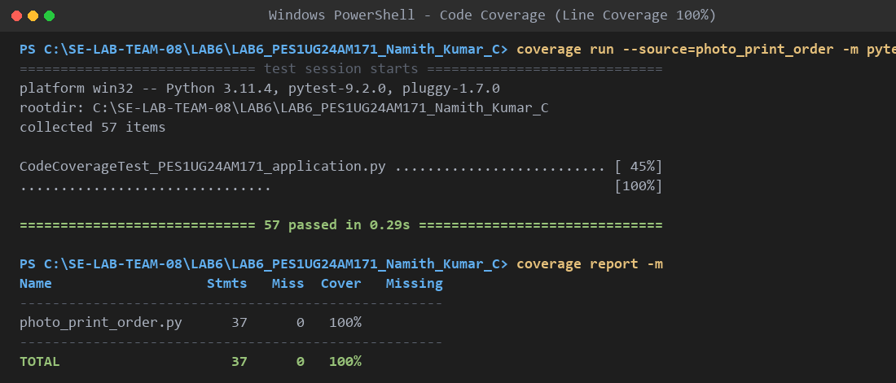
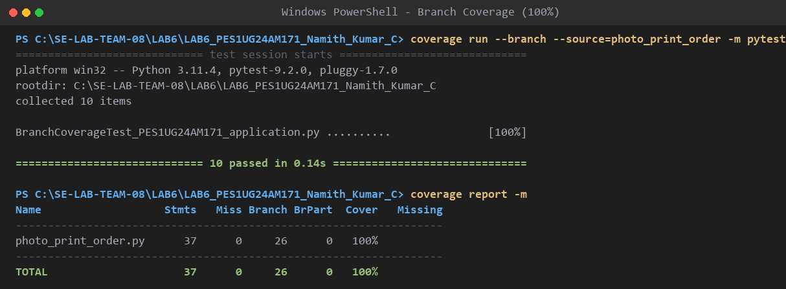

# Lab 6: Code and Branch Coverage Analysis

## Student Details
- **Student Name**: Namith Kumar C
- **SRN**: PES1UG24AM171
- **Course**: Software Engineering Lab (UE24CS252AA)
- **Assigned Repository**: `SETAPESU26/L6_L7_46_photo_print_order`
- **Application Scenario**: Photo Print Order
- **Application Module**: `photo_print_order.py`
- **Starter Test File**: `test_photo_print_order.py`

---

## Deliverable Test Suites

1. **Code Coverage Test Suite**:
   - **File**: `CodeCoverageTest_PES1UG24AM171_application.py`
   - **Description**: Comprehensive pytest suite systematically exercising every executable line, statement, constant definition, and exception path in `photo_print_order.py`.
   - **Total Tests**: 57 test cases.
   - **Line Coverage Achieved**: **100%** (37 / 37 statements covered).

2. **Branch Coverage Test Suite**:
   - **File**: `BranchCoverageTest_PES1UG24AM171_application.py`
   - **Description**: Decision-focused pytest suite specifically testing every True and False conditional branch, compound boolean predicates, and boundary conditions.
   - **Total Tests**: 10 comprehensive multi-assertion test functions.
   - **Branch Coverage Achieved**: **100%** (26 / 26 decision branches evaluated).

---

## Commands to Run Tests and Generate Coverage Reports

### 1. Code Coverage (Line Coverage)
Run pytest with code coverage tracking:
```bash
coverage run --source=photo_print_order -m pytest CodeCoverageTest_PES1UG24AM171_application.py
```

Display line coverage report with missing line breakdown:
```bash
coverage report -m
```

### 2. Branch Coverage
Run pytest with branch coverage tracking:
```bash
coverage run --branch --source=photo_print_order -m pytest BranchCoverageTest_PES1UG24AM171_application.py
```

Display branch coverage report with partial branch breakdown:
```bash
coverage report -m
```

---

## Coverage Analysis & Comparison

| Test Suite | Metric | Stmts | Miss | Branches | BrPart | Coverage | Missing Paths |
|---|---|---|---|---|---|---|---|
| **Starter Tests (`test_photo_print_order.py`)** | Line & Branch | 37 | 23 | 26 | 6 | **32%** | Lines: 6, 8, 11, 15-23, 28, 30, 35-45 |
| **Code Coverage Suite (`CodeCoverageTest_PES1UG24AM171_application.py`)** | Line Coverage | 37 | 0 | - | - | **100%** | None (All 37 statements covered) |
| **Branch Coverage Suite (`BranchCoverageTest_PES1UG24AM171_application.py`)** | Branch Coverage | 37 | 0 | 26 | 0 | **100%** | None (All 26 branches covered) |

### Key Observations:
- **Baseline Starter Suite**: Evaluated only 2 basic positive happy paths. Left 23 statements untested (62% missing) and missed 6 decision branches, resulting in an inadequate 32% coverage.
- **Code Coverage Suite**: Expanded test coverage across all boundary values (such as included copies limits, valid/invalid print sizes, non-rush vs rush files, and dispatch cutoff margins), achieving a full **100% line coverage**.
- **Branch Coverage Suite**: Targeted both boolean evaluations for every conditional branch and compound condition, specifically isolating compound short-circuit behavior (e.g. member status and 8x10 print size exclusion), achieving **100% branch coverage**.

---

## Detailed Decision & Branch Coverage Mapping

All 14 decision points and 26 branch outcomes across `photo_print_order.py` are comprehensively verified:

| # | Function | Decision / Predicate | True Branch | False Branch |
|---|----------|----------------------|-------------|--------------|
| 1 | `extra_print_charge` | `if print_size not in INCLUDED_PRINTS:` | Unknown size raises `ValueError("unknown print size")` | Supported size ("4x6", "5x7", "8x10") proceeds |
| 2 | `extra_print_charge` | `if copies < 0:` | Negative count raises `ValueError("invalid copies")` | Non-negative count (`>= 0`) proceeds |
| 3 | `extra_print_charge` | `if is_member and print_size != "8x10":` | Member + non-8x10 adds 5 included prints | Non-member or 8x10 keeps base included prints |
| 4 | `extra_print_charge` | `if extra <= 0:` | Within included allowance returns charge `0` | Extra copies proceed to rate calculation |
| 5 | `extra_print_charge` | `if finish == "matte":` | Base rate set to 4 | Base rate set to 7 (e.g., glossy or canvas) |
| 6 | `extra_print_charge` | `if extra > 50:` | Extra copies > 50 adds volume surcharge (+2) | Extra copies $\le 50$ retains base rate |
| 7 | `extra_print_charge` | `if finish == "canvas":` (nested) | Canvas finish adds texture surcharge (+5) | Non-canvas finishes retain +2 rate |
| 8 | `order_valid` | `if is_rush:` | Returns `copies <= 50` (tests True and False) | Standard non-rush order proceeds |
| 9 | `order_valid` | `if file_mb > 25:` | Oversized file returns `False` immediately | File $\le 25$ MB proceeds to copy limit check |
| 10 | `order_valid` | `return copies <= 500` | Copies $\le 500$ returns `True` | Copies > 500 returns `False` |
| 11 | `dispatch_status` | `if is_framed:` | Base cutoff set to 24 hours | Base cutoff set to 12 hours |
| 12 | `dispatch_status` | `if is_international:` | Additional 24 hours added to cutoff | Domestic cutoff remains base value |
| 13 | `dispatch_status` | `if hours_before_dispatch >= cutoff:` | Dispatch status returns `"on_time"` | Proceeds to tight threshold check |
| 14 | `dispatch_status` | `elif hours_before_dispatch >= cutoff - 6:` | Dispatch status returns `"tight"` | Status falls through to `"missed"` |

---

## Terminal Screenshots

### 1. Code Coverage Terminal Output (100% Line Coverage)


### 2. Branch Coverage Terminal Output (100% Branch Coverage)

